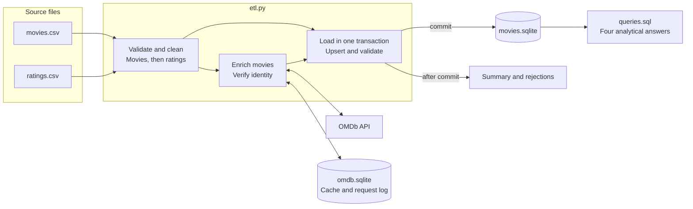
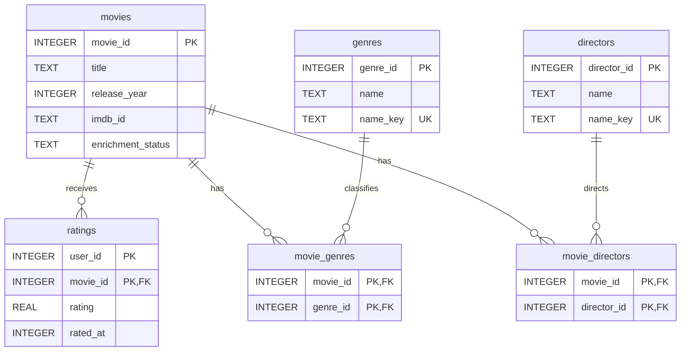

# MovieLens and OMDb pipeline

This project turns two MovieLens CSV files into a local SQLite database for movie analysis. It validates movies and ratings, enriches movie records with OMDb metadata, and answers four analytical questions with SQL.

[Architecture](#architecture) | [Data model](#data-model) | [Setup](#setup) | [Results](#results)

| File | Purpose |
| --- | --- |
| `etl.py` | The pipeline: read, clean, enrich, load, report. |
| `schema.sql` | The database: six tables for the data and one small manifest table. |
| `queries.sql` | The four analytical questions. |
| `README.md` | This file. |

## Architecture

The pipeline runs as one local batch job. MovieLens supplies the movies, genres and user ratings; OMDb supplies optional details such as directors, plot, release date and box office. SQLite suits this workload because it provides relational queries and transactions in a local file, with no database server to manage.



1. **Extract and validate.** Read each CSV once, hash the same bytes, and parse with the standard CSV reader. A bad row gets a rejection reason; damaged file structure stops the run.
2. **Transform.** Clean movies first so ratings can be checked against valid movie IDs. Resolve duplicates, derive the release year, and split each genre list into distinct memberships.
3. **Enrich.** Look up each accepted movie independently of its ratings. Reuse cached responses, verify identity, and keep unavailable optional values as `NULL`. Unfinished lookups remain pending or retryable.
4. **Load and query.** Write the accepted rows and lookup decisions in one transaction. Check counts, foreign keys and director credits before committing, then write reports. SQL joins produce the four answers.

**The publication boundary matters.** All HTTP work happens before the load transaction begins, so slow API responses do not hold a database write lock. The cache is saved independently: if loading fails, its successful responses can be reused. If publication succeeds but saving reports fails, the exit code makes that distinction clear.

Movies and ratings stay in separate related tables. Enrichment runs once per movie, while joins combine the data when a question needs it. This avoids repeating movie metadata for every rating or multiplying rating rows through unrelated genre and director joins.

## Data model



The diagram shows the six data tables and their main fields. `PK` means primary key, `FK` means foreign key, and `UK` means unique key. Two fields marked `PK` form one composite key.

| Table | One row represents | Key |
| --- | --- | --- |
| `movies` | One MovieLens movie, with optional OMDb details | `movie_id` |
| `ratings` | One user's current rating of one movie | `(user_id, movie_id)` |
| `genres` | One normalized genre name | `genre_id`; unique `name_key` |
| `movie_genres` | One movie's membership in one genre | `(movie_id, genre_id)` |
| `directors` | One normalized director name | `director_id`; unique `name_key` |
| `movie_directors` | One director's credit on one movie | `(movie_id, director_id)` |
| `dataset_manifest` | The input hashes and fixed validation cutoff | A single row keyed by `1` |

The manifest has no movie relationship. It records which CSV snapshot built the database and keeps timestamp validation consistent on reruns. A changed snapshot requires a new database path.

For example, "Toy Story (1995)" becomes one movie with the title "Toy Story" and year 1995. Its five genres become five memberships. Its 215 user ratings remain 215 separate rows. One user can rate many movies, and many users can rate the same movie; the pair identifies a current rating. No users table is needed because these inputs provide no user attributes.

MovieLens IDs and IMDb IDs are separate identifiers. Genres remain owned by MovieLens, even if OMDb reports different ones. A movie can have several directors, so credits use a link table. `name_key` normalizes case and spacing without removing accents. Optional metadata remains nullable, and every movie has an explicit enrichment status.

`STRICT` tables enforce compatible stored types. Check constraints restrict ratings and IDs, while foreign keys prevent orphan records. `PRAGMA foreign_keys = ON` is enabled and checked on each pipeline connection. `PRAGMA user_version = 2` marks format compatibility; it does not perform migrations.

## Requirements

You need Python 3.11 or newer and SQLite 3.37 or newer, because the tables use SQLite's `STRICT` mode. Python's built-in `sqlite3` module is used; check its version with `python3 -c "import sqlite3; print(sqlite3.sqlite_version)"`. The only external packages are `requests` and `python-dotenv`. I ran it on macOS.

## Setup

The code and the data live side by side. `etl.py` looks for a `runtime` folder next to the repository folder and never writes inside the repository.

```text
movie-project/
  movie-pipeline/   this repository
  runtime/          virtual environment, .env, CSV files, database, cache, reports
```

```bash
mkdir movie-project && cd movie-project
git clone https://github.com/saketh12e/tsworks-movie-pipeline.git movie-pipeline

python3 -m venv runtime/.venv
source runtime/.venv/bin/activate
python -m pip install requests==2.34.2 python-dotenv==1.2.4

mkdir -p runtime/raw
curl -L -o runtime/ml-latest-small.zip https://files.grouplens.org/datasets/movielens/ml-latest-small.zip
unzip -j runtime/ml-latest-small.zip ml-latest-small/movies.csv ml-latest-small/ratings.csv -d runtime/raw
```

Get a free OMDb key at <https://www.omdbapi.com/apikey.aspx> and activate it from the email. Then create `runtime/.env` in a text editor with one line:

```text
OMDB_API_KEY=your_key_here
```

`etl.py` loads that file with `python-dotenv` (`override=False`) and then reads `os.getenv("OMDB_API_KEY")`. If the variable is already set in your shell, the shell value wins. Offline runs need no key.

## Running

```bash
cd movie-pipeline
python etl.py --offline              # clean and load the CSV files, no API calls
python etl.py                        # clean, make up to 200 OMDb requests, then load
python etl.py --max-api-calls 50     # a smaller batch
```

| Option | Meaning |
| --- | --- |
| `--work-dir PATH` | Folder with `raw/`, `.env` and the outputs. Default: `../runtime` next to `etl.py`. |
| `--db PATH` | Database file. Default: `WORK_DIR/movies.sqlite`. |
| `--offline` | Make no HTTP requests. Cached answers are still used. |
| `--max-api-calls N` | HTTP attempts this run may make, retries included (default 200). |

Relative paths are resolved from the folder you run the command in. Run one ETL process at a time.

| Exit code | Meaning |
| --- | --- |
| 0 | Published, and every movie has a final lookup decision. "Not found" and "ambiguous" are final decisions, not matches. |
| 2 | Published, but some movies are still pending or failed. Run again to continue. |
| 1 | Nothing new was published. The message explains why. |
| 3 | The database was published, but the report files could not be saved. |

Each run prints a summary and writes `runtime/reports/movies.report.json` and `movies.rejections.jsonl`, one line per rejected CSV row with its row number, line number and reason.

## Looking at the data

Run the four queries from the repository folder:

```bash
sqlite3 -readonly -header -column ../runtime/movies.sqlite < queries.sql
```

SQLite keeps the whole database in one file, so there is no server to start. For a graphical view, install DB Browser for SQLite from <https://sqlitebrowser.org/dl/>, then:

1. Open DB Browser for SQLite.
2. Choose Open Database and select `../runtime/movies.sqlite`. Open the database file, not `schema.sql` or `queries.sql`.
3. Use Database Structure to see the tables, keys and indexes.
4. Use Browse Data and its table selector to see the movie, rating, genre and director rows.
5. Use Execute SQL to open `queries.sql`, or run a query such as `SELECT * FROM movies LIMIT 20;`.

From the terminal, read-only:

```bash
sqlite3 -readonly ../runtime/movies.sqlite
```

```text
.tables
.schema movies
.headers on
.mode column
SELECT movie_id, title, release_year FROM movies LIMIT 10;
.read queries.sql
.quit
```

Lines starting with a dot are commands of the `sqlite3` shell, not SQL, so they don't work in DB Browser's SQL editor. Plain `SELECT` statements work in both. See <https://sqlitebrowser.org/> and <https://www.sqlite.org/cli.html>.

## Cleaning rules

A movie needs an ID and a title. A rating needs a user ID, movie ID, rating and timestamp. Rows missing any of these are rejected; nothing is filled in with zero. Optional data stays empty: a movie without a year, genres or director is kept. A title that is literally `NA` stays a title.

**Field checks:**

- **IDs** are positive whole numbers. Leading zeros are fine; signs, decimals and exponents are not.
- **Ratings** must equal one of 0.5, 1.0, ... 5.0 exactly. Values are never rounded into range.
- **Timestamps** are Unix seconds. The first load records the current time as the cutoff, and timestamps more than 24 hours after it are rejected. Reruns reuse the stored cutoff.
- **Title year:** only a final `(1995)` comes off the title; other parentheses stay.
- **Genres** are split on `|`. `(no genres listed)` means no genres.

**Feature engineering:** The pipeline derives `release_year` from the movie title and turns pipe-separated genres into individual genre memberships. These transformations make the data easier to query and cover the genre-parsing bonus described in the assignment.

**Duplicates.** Rows are validated first and duplicates are resolved afterwards, among the valid rows only:

- **Same movie ID, same content:** keep one row.
- **Same movie ID, conflicting content:** reject every row for that ID, plus its ratings.
- **Different movie IDs with the same title:** they stay separate movies.
- **Same user and movie more than once:** keep the latest timestamp; older rows are superseded. If two different scores share the latest timestamp, the whole pair is rejected.

Every row ends as selected, duplicate, superseded or rejected, and the run checks that these add up.

## Matching movies on OMDb

Each movie is looked up once, never once per rating, by title and year (`t=` and `y=`). The pipeline also tries up to three spelling variants that MovieLens titles need: a trailing article moved to the front ("American President, The" becomes "The American President"), and a final alternate title in parentheses, with its main title.

A reply is accepted only if all of these hold:

- it has a valid IMDb ID and a type of movie, series or episode;
- its title matches one of the variants, ignoring case, spacing and punctuation;
- its year, or the first year of a series, equals the MovieLens year.

A movie without a year is searched first, and a match needs exactly one exact-title candidate in a complete result list. A truncated list or several candidates mark the movie `ambiguous`. OMDb genres are ignored, so genres always come from MovieLens.

**API limits:**

- **Request budgets.** Each run may make 200 HTTP attempts (`--max-api-calls`). Across all runs the limit is 900 in any 24 hours, below the free key's 1,000. Each movie gets at most 6 attempts and each request at most 3.
- **Request log.** Every attempt is first written to a request log in `runtime/cache/omdb.sqlite`, so a crash still counts it.
- **Retries.** Timeouts, connection errors and 5xx replies are retried after a short wait. A numeric `Retry-After` up to 30 seconds is obeyed; a longer one, or a 429 without a usable number (HTTP-date values are not supported), stops requests for the run.
- **Stopping early.** Three movies in a row failing on connectivity also stop requests. An invalid key stops the run before anything is published. OMDb's own quota message stops requests, but the work done so far is still published.
- **Cache.** Successful answers are cached for 30 days and "not found" answers for 24 hours. Offline runs may reuse older successes and report how many were stale.

## One transaction and reruns

All movies, ratings, genres, lookup results and director credits are written in one transaction. Before committing, the run checks the row counts, foreign keys, and that director credits and OMDb details belong only to matched movies. If anything fails, the whole transaction is rolled back.

Reruns are idempotent. The manifest ties the database to the exact CSV files and the cutoff, and every write is an upsert on the natural keys, so an unchanged rerun leaves the database identical. Movies that already have a decision are skipped, and pending movies continue where the last run stopped. If the CSV files change, the run refuses the old database and asks for a new `--db` path.

## Results

I measured these on 5 November 2026, using the four files in this repository.

- **Loaded:** all 9,742 movies and 100,836 ratings from 610 users, with nothing rejected and no duplicates. 18 movies have no ratings, 34 have no genres and 13 have no year in the title; all were kept. There are 19 genres and 22,050 movie and genre links.
- **Lookups:** 341 movies (IDs 1 to 383) have a decision: 286 matched, 42 not found and 13 ambiguous. 9,401 are still pending. 286 movies (2.9%) have director data.

The answers:

1. **Highest average rating:** 296 movies are tied at 5.0, and none has more than two ratings. The query returns all of them, with their rating counts.
2. **Top genres:** Film-Noir 3.920, War 3.808, Documentary 3.798, Crime 3.658 and Drama 3.656.
3. **Director with the most movies:** Krzysztof Kieslowski and Robert Rodriguez, with 3 movies each, but only among the 286 movies that have director data. This is not yet an answer for the whole dataset.
4. **Average per year:** 106 years from 1902 to 2018. 13 movies with 18 ratings have no known year and are left out.

Averages use every rating row. A movie rated 5 once and another rated 1 three times average 2.0 together, not 3.0, because each rating counts once.

## Challenges and next steps

Matching was the hard part. OMDb's title lookup sometimes returns a different item; asking for "Nixon" (1995) returned "Kissinger and Nixon". So every reply is verified, and a missed match is preferred to a wrong one. The request limit was the other constraint: enrichment runs in budgeted batches, and the report shows the actual coverage.

Possible improvements:

- Use MovieLens's `links.csv` for IMDb IDs, if extra input becomes allowed.
- Better identity resolution for titles OMDb spells differently.
- Incremental updates when the CSV files change.
- Concurrency and scheduled runs, if the workload grows.

## Limitations

These are left out on purpose:

- **Concurrency.** Concurrent ETL runs and several clients sharing one key aren't supported; the request budget only covers this cache folder.
- **Updates.** Incremental CSV updates, merging changed files, and migrations from older database formats aren't supported.
- **Re-checking.** Matched movies are never refreshed, and decided movies are never re-checked automatically.
- **Matching.** There is no fuzzy matching, no search beyond the first page, no manual review screen, and `links.csv` isn't used. Agreement on title and year reduces risk but cannot tell apart different works with the same title and year.
- **Directors.** They are identified by normalized name, so two people with the same name count as one. Names come from OMDb's comma-separated list, which can split some names wrongly.
- **OMDb formats.** Only dollar box office figures and OMDb's English date format are read.
- **Rate limits.** `Retry-After` given as an HTTP date isn't supported.
- **Scale and operations.** There is no support for input much larger than this dataset, streaming of huge files, cloud deployment, scheduling, dashboards or alerting.
- **No shared commit.** The database, the cache and the reports don't share one atomic commit.

Even when every movie has a final decision, some will stay not found or ambiguous.
